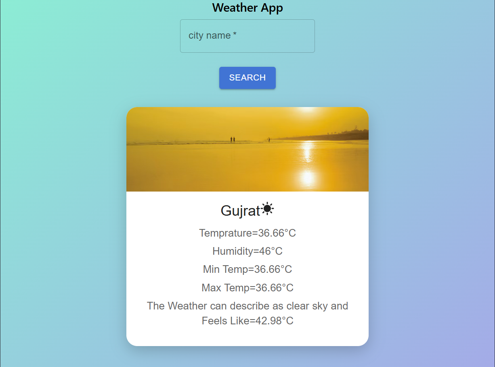

# Weather App

A React weather dashboard where you can search for a city and view its current conditions, temperature, feels-like temperature, humidity, and daily high and low.

## Screenshot



## Run locally

```bash
npm install
npm run dev
```

## Build and checks

```bash
npm run build
npm run lint
```

Built with React, Vite, and Material UI.
